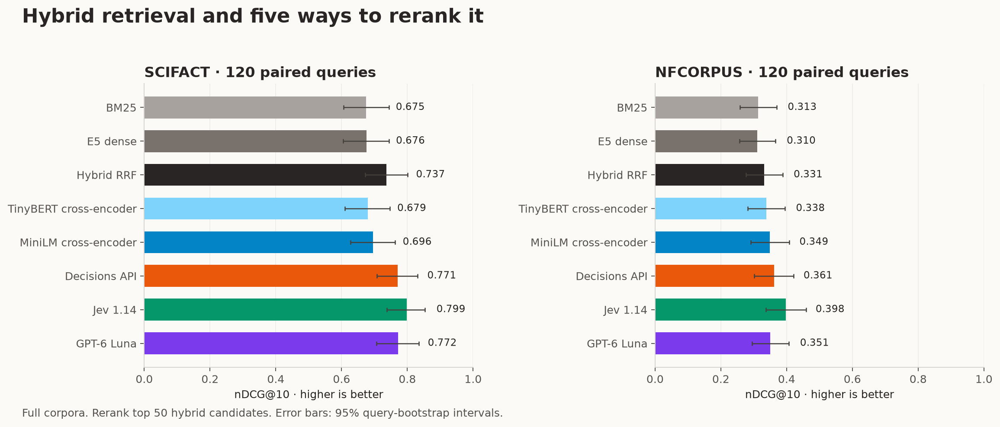
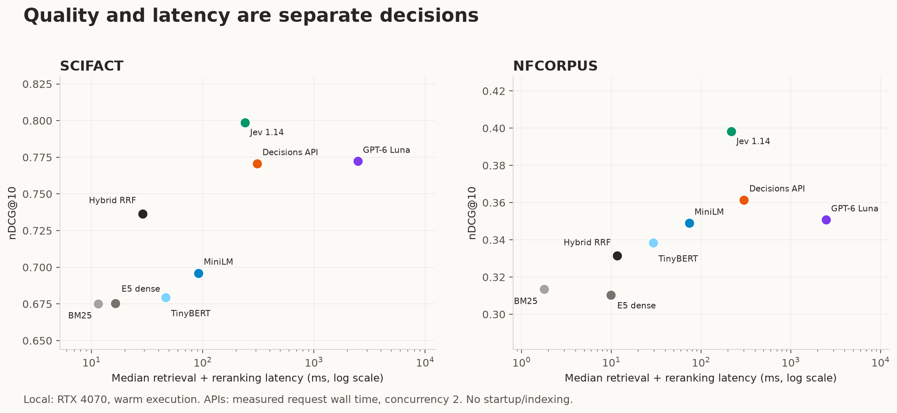
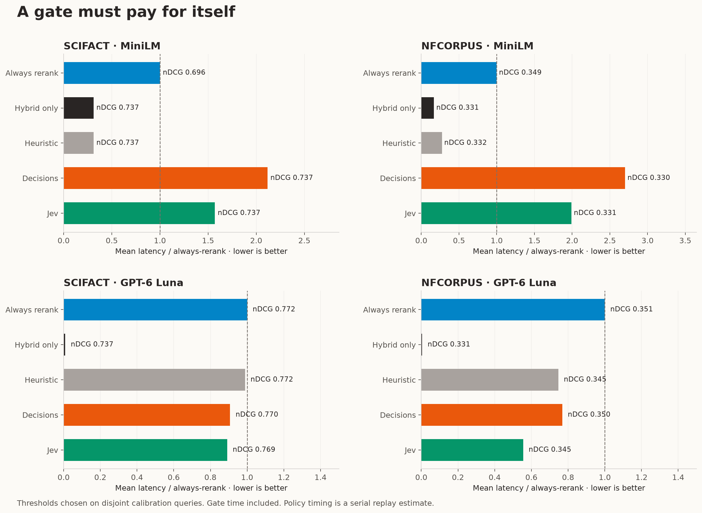

# When reranking pays off in hybrid search

A measured comparison of two cross-encoders, GPT-6 Luna, Jev 1.14, and OpenAI Decisions—with a second experiment on deciding when to skip reranking.

I wanted to answer two questions about the same search pipeline: which reranker improves the results, and whether an extra model call can tell me when reranking is worth doing. I built a full-corpus hybrid retriever, held its candidates fixed, and measured relevance, latency, and API usage.

Jev produced the highest mean nDCG@10 on both API samples. The routing result depended on the downstream reranker: calibrated API gates reduced estimated GPT latency, but slowed every MiniLM pipeline I tested. Skipping work and improving a search system turned out to require separate checks.

## The search pipeline

I used the BEIR versions of [SciFact](https://github.com/allenai/scifact), which retrieves evidence for scientific claims, and [NFCorpus](https://www.cl.uni-heidelberg.de/statnlpgroup/nfcorpus/), which retrieves medical literature for nutrition-related information needs. The corpus sizes below refer to the [BEIR distributions](https://github.com/beir-cellar/beir), rather than the original NFCorpus release.

| Dataset | Documents | Full local test | Paired API test | Separate calibration |
| --- | ---: | ---: | ---: | ---: |
| SciFact | 5,183 | 300 | 120 | 80 from train |
| NFCorpus | 3,633 | 323 | 120 | 80 from dev |

The API samples and calibration queries were selected by a fixed hash ordering with seed `20261021`. Calibration and test sets share neither query IDs nor normalized query text. The local baselines cover all 623 official test queries; comparisons involving APIs use the same 120 test queries within each dataset.

The first stage combines BM25 with `intfloat/e5-small-v2`. BM25 uses English stemming, `k1=1.2`, and `b=0.75`; E5 uses normalized embeddings and exact cosine search over the complete corpus, with its documented [query and passage prefixes](https://huggingface.co/intfloat/e5-small-v2). I merge each retriever's top 100 using equal-weight reciprocal rank fusion:

`RRF(document) = sum(1 / (60 + rank_in_retriever))`

A document contributes only through retrievers that returned it. Each reranker reorders the first 50 hybrid candidates and preserves the remaining hybrid tail through rank 100. Every reranker receives the same candidates and excerpts: at most 384 MiniLM WordPiece tokens per passage and 96 per query. This isolates ordering improvements from changes to retrieval.

I compared `cross-encoder/ms-marco-TinyBERT-L2-v2`, `cross-encoder/ms-marco-MiniLM-L6-v2`, GPT-6 Luna through Responses, Jev `jev-1.14.0`, and GPT-6 Luna through Decisions. The two cross-encoders are small, established MS MARCO baselines; they do not represent the strongest available cross-encoder family.

All three APIs use the same four-level relevance rubric: unrelated, topically related, partially relevant, and highly relevant. Evidence that refutes a scientific claim counts as relevant. [Decisions](https://developers.openai.com/api/docs/guides/decisions) and [Jev](https://docs.typesafe.ai/api/system-one) receive one score question per candidate and return expected rubric scores. GPT receives all 50 passages in one structured-output request, with reasoning disabled, and returns numeric scores. That shared GPT context is a real difference in request design. Stable hybrid order breaks tied scores.

## What improved relevance?

The primary measure is TREC-style linear-gain nDCG@10: higher scores mean that more relevant documents appear closer to the top. This table uses only the paired 120-query samples.

| Method | SciFact nDCG@10 | NFCorpus nDCG@10 |
| --- | ---: | ---: |
| BM25 | 0.6751 | 0.3134 |
| E5 dense | 0.6755 | 0.3104 |
| Hybrid RRF | 0.7366 | 0.3314 |
| TinyBERT cross-encoder | 0.6794 | 0.3384 |
| MiniLM cross-encoder | 0.6960 | 0.3490 |
| Decisions API | 0.7707 | 0.3615 |
| Jev 1.14 | 0.7986 | 0.3982 |
| GPT-6 Luna | 0.7723 | 0.3508 |

Jev improved on hybrid by 0.0621 nDCG on SciFact and 0.0667 on NFCorpus. Its advantage over GPT was less certain on SciFact: the paired difference was +0.0263 [-0.0158, 0.0703]. On NFCorpus, that difference was +0.0474 [0.0258, 0.0706]. The point-estimate ordering is clearer than a claim that the same winner will hold on another task.

MiniLM lowered SciFact's mean score while improving NFCorpus's. The same fast reranker therefore had different value after the same retrieval architecture. A relevance benchmark belongs before an unconditional reranking decision.

For context, these are the full-test local results. They are separate from the API sample table.

| Method | SciFact · 300 queries | NFCorpus · 323 queries |
| --- | ---: | ---: |
| BM25 | 0.6765 | 0.3200 |
| E5 dense | 0.6875 | 0.3255 |
| Hybrid RRF | 0.7258 | 0.3461 |
| TinyBERT cross-encoder | 0.6684 | 0.3368 |
| MiniLM cross-encoder | 0.6968 | 0.3565 |

Hybrid Recall@50 was 0.9417 on the SciFact sample and 0.2443 on NFCorpus. Every reranker has the same Recall@50 here by construction. Reordering the shortlist cannot recover a relevant document outside it; NFCorpus leaves substantial room for improving retrieval itself.

The full measurements also include MRR@10 and Recall@50/100. Unjudged documents count as zero relevance. Confidence intervals come from 5,000 paired query-bootstrap resamples; they are exploratory intervals without a multiple-comparison adjustment.

## Latency and token cost changed the ranking

I ran the local models warm on an RTX 4070 and measured each API request at concurrency two. The table includes retrieval plus the final HTTP request duration, including an error response when fallback was used. Benchmark pacing, earlier failed attempts, and retry backoff are excluded; operational failures are reported below.

| Method | SciFact p50 / p95 ms | NFCorpus p50 / p95 ms | API USD / 1,000 queries · Sci / NF |
| --- | ---: | ---: | ---: |
| Hybrid RRF | 29 / 39 | 12 / 20 | 0.000 / 0.000 |
| TinyBERT cross-encoder | 47 / 57 | 29 / 37 | 0.000 / 0.000 |
| MiniLM cross-encoder | 92 / 105 | 74 / 82 | 0.000 / 0.000 |
| Decisions API | 309 / 418 | 302 / 639 | 2.618 / 2.645 |
| Jev 1.14 | 239 / 560 | 217 / 285 | 1.015 / 1.022 |
| GPT-6 Luna | 2477 / 5881 | 2466 / 4927 | 1.714 / 1.755 |

Jev was the fastest API reranker by median request-plus-retrieval time in both samples and had the lowest measured API token cost. Decisions was much faster than GPT generation, while the local cross-encoders were faster again.

With this request design, Decisions cost more per query than GPT despite having no output-token charge. Its candidate-specific questions repeat scoring instructions and rubric structure, producing more input tokens. The application-level bill depends on the complete request, as well as the price per token.

Costs are estimates from observed usage and standard list prices at the time of the run. [GPT-6 Luna](https://developers.openai.com/api/docs/models/gpt-6-luna) was $0.10 per million input tokens and $0.50 per million output tokens; [Decisions](https://developers.openai.com/api/docs/guides/decisions) charged $0.10 per million input tokens; [Jev 1.14](https://docs.typesafe.ai/models) charged $0.042 per million input tokens with free output. The cost columns exclude local GPU, indexing, hosting, and engineering costs. A zero API charge for a local model does not make its infrastructure free.

## Can a model decide when to rerank?

For the routing experiment, a Decisions predicate or Jev Noul estimates whether reranking would improve nDCG@10 by at least 0.02. The gate sees the query, the first 50 candidates as short snippets, retrieval agreement, and the RRF score margin. It never sees relevance judgments or reranker outputs. One request asks separate questions about MiniLM and GPT reranking.

I evaluated a fixed probability threshold of 0.5 and a calibration-only threshold. The latter minimizes the reranking rate while keeping calibration mean nDCG@10 within 0.01 of always reranking. This is a threshold-selection rule; it does not guarantee a one-point quality bound on new queries. A simple disagreement gate—one minus BM25/dense top-10 Jaccard overlap—provides a baseline with no additional API call.

The calibrated API policies below use the entire measured two-question gate request as overhead. A one-question implementation could have different costs.

| Dataset | Target | Gate | Skip | nDCG@10 | Δ vs always [95% CI] | Mean ms | API USD / 1k |
| --- | ---: | ---: | ---: | ---: | ---: | ---: | ---: |
| SciFact | MiniLM | Decisions (t=0.85) | 100.0% | 0.7366 | +0.0405 [-0.0042, 0.0867] | 195 | 0.420 |
| SciFact | MiniLM | Jev (t=0.70) | 98.3% | 0.7366 | +0.0405 [-0.0042, 0.0867] | 144 | 0.204 |
| SciFact | GPT | Decisions (t=0.45) | 15.8% | 0.7696 | -0.0027 [-0.0092, 0.0009] | 2871 | 1.864 |
| SciFact | GPT | Jev (t=0.60) | 15.0% | 0.7691 | -0.0032 [-0.0112, 0.0032] | 2820 | 1.646 |
| NFCorpus | MiniLM | Decisions (t=0.80) | 94.2% | 0.3297 | -0.0193 [-0.0371, -0.0028] | 199 | 0.403 |
| NFCorpus | MiniLM | Jev (t=0.75) | 99.2% | 0.3314 | -0.0175 [-0.0356, -0.0004] | 147 | 0.195 |
| NFCorpus | GPT | Decisions (t=0.60) | 28.3% | 0.3504 | -0.0004 [-0.0063, 0.0054] | 2116 | 1.662 |
| NFCorpus | GPT | Jev (t=0.65) | 47.5% | 0.3446 | -0.0062 [-0.0130, 0.0005] | 1528 | 1.118 |

Here, Δ nDCG is relative to always using the named reranker. Latency is the mean of retrieval + gate + reranking only when selected. These policy timings are serial replay estimates built from independently measured query outcomes, not measurements of a deployed end-to-end router.

Before MiniLM, mean gate overhead alone ranged from 115 to 183 ms. The reranking work available to save averaged only about 61–63 ms. The calibrated gates consequently added latency even when they skipped almost everything. On SciFact, disabling MiniLM recovered hybrid's higher mean quality; hybrid-only already achieved that result with less latency. On NFCorpus, the calibrated API policies lost 0.0175–0.0193 nDCG versus always using MiniLM, exceeding the 0.01 calibration allowance on held-out queries.

Before GPT, Decisions reduced estimated mean latency by 9.3% on SciFact and 23.2% on NFCorpus. Jev reduced it by 10.9% and 44.5%. Their measured quality drops ranged from 0.0004 to 0.0062 nDCG, with the uncertainty shown in the table. The Jev/NFCorpus interval still allows a loss greater than 0.01; calibration did not establish a guaranteed test-quality bound.

Latency savings also differed from token savings. The Decisions gate on SciFact raised API cost from USD 1.714 to 1.864 per 1,000 queries while reducing estimated latency. The extra decision had its own bill.

Benefit prediction was weak: the API gates' GPT-benefit AUROCs ranged from 0.480 to 0.595, where 0.5 is chance-level discrimination. Their measured trade-offs call for validation on the intended workload, including whether simple retrieval features achieve a similar result. Threshold choice mattered too: at the fixed 0.5 threshold, the Jev gate skipped only 1.7% of SciFact GPT calls and slightly increased mean latency.

The break-even condition is straightforward:

`mean gate time < mean reranking time avoided`

The right-hand side must account for which queries are skipped, because reranker durations vary. A high skip percentage alone says little about the latency saved or the relevance lost.

The disagreement baseline also deserved attention. Before GPT on NFCorpus, its calibrated policy skipped 25.8%, reduced estimated mean latency by 25.3%, and lost 0.0055 nDCG. Comparing API gates against simple retrieval features was necessary to assess their added value.

## Individual queries still matter

Aggregate gains hide reversals. On SciFact query 913, about PPAR-RXR inhibition, hybrid search had nDCG@10 of 0.000 and Jev reached 1.000 by promoting the judged-relevant abstract. On query 475, about glycolysis as a primary pathway, hybrid started at 1.000 and Jev fell to 0.000. Those examples describe benchmark judgments, including the convention that unjudged alternatives receive zero; they are not explanations of the models' internal reasoning.

Six of the 400 GPT reranking query evaluations ended in non-retryable `invalid_prompt` rejections: one SciFact test query, two NFCorpus test queries, and three NFCorpus calibration queries. They remain in the results with hybrid-order fallback. Incomplete structured responses were retried; rate limits and transient connection failures are recorded in the ledger. Reported latency excludes earlier failed attempts and retry delays, so it should not be read as production tail latency.

## What I would take into a search system

For these configurations, Jev offered the strongest measured relevance–API-cost combination. The small local cross-encoders offered much lower latency, with quality gains that depended on the dataset. GPT improved on hybrid in both samples, but its generation time created a larger opportunity for selective execution.

I would retain hybrid as the explicit fallback, benchmark the chosen reranker on the application's queries, and add a gate only after measuring the complete route. Before a fast local cross-encoder, this particular API gate was too expensive in time. Before GPT, calibrated routing offered a measurable latency trade-off, with quality uncertainty that still needs an application-specific decision.

These results cover two English biomedical retrieval tasks, one embedding model, two small cross-encoders, fixed API prompts, and one excerpting scheme. They do not establish a universal ordering of model families. Model exposure to these public benchmarks during pretraining was not audited, API generations were not repeated across seeds, and warm successful-request latency does not describe cold starts or production failure tails.

The useful outcome is a measured decision boundary: choose a reranker against the application's relevance needs, then evaluate a gate against that specific reranker's cost and latency. Passage relevance and the marginal value of reranking need separate measurements.

## Reproduce the experiment

The recorded API usage estimate was USD 2.43, below the USD 5 cap, across 2,026 recorded request attempts. This includes conservative estimates for recorded network failures; tiny preflight calls and a few interrupted in-flight requests sit outside the ledger. The final integrity audit passed, including candidate identity, complete result coverage, and calibration/test separation.

The [experiment protocol](../EXPERIMENT_PROTOCOL.md) records the splits, prompts, timing definitions, fallback behavior, and limitations. [Metrics CSV](../results/metrics.csv), [routing CSV](../results/gates.csv), and [complete summary](../results/summary.json) accompany the article. The [project guide](../README.md) contains the commands; the software lockfile, open-model revisions, dataset checksums, frozen query IDs, and per-query numeric results are included in the source bundle. Downloaded corpora, model weights, and credentials are excluded.
